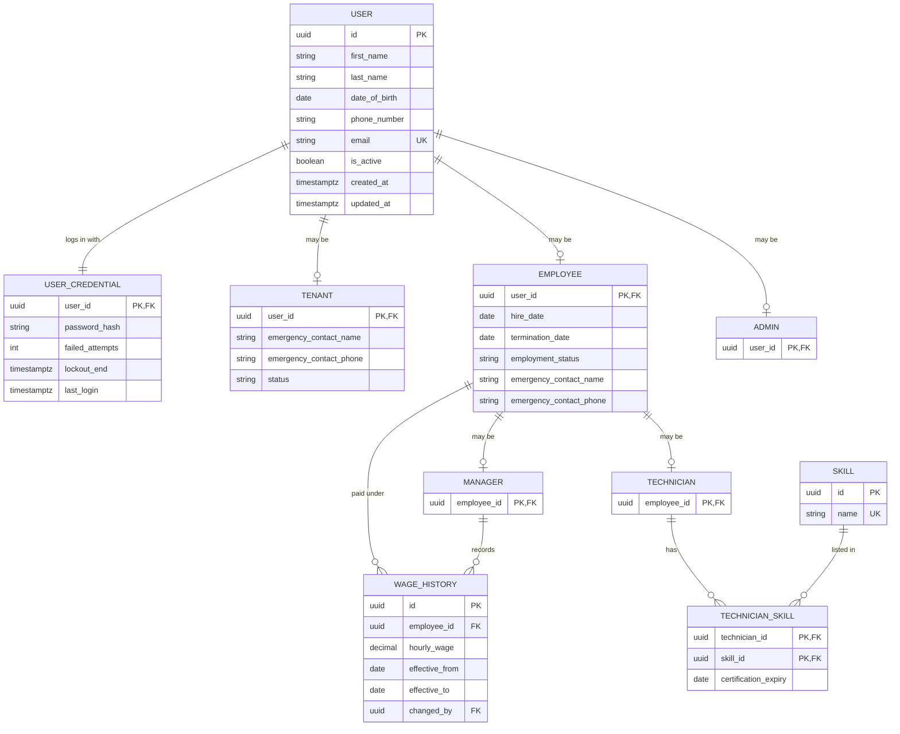
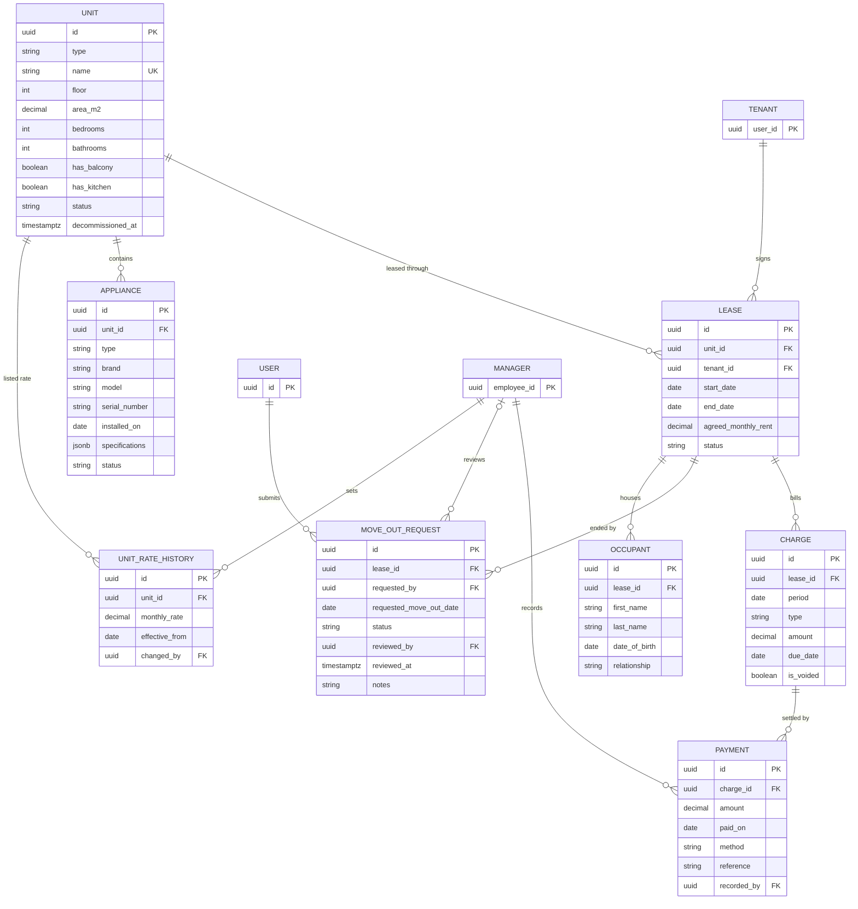
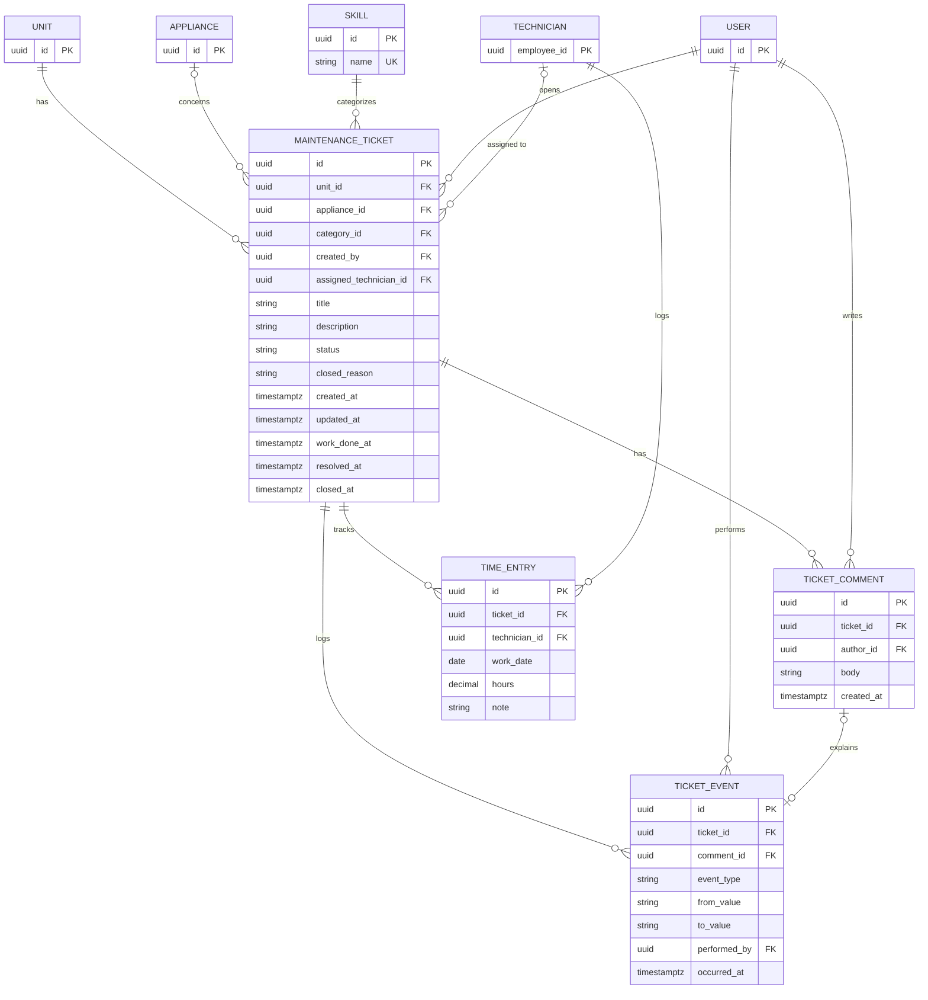
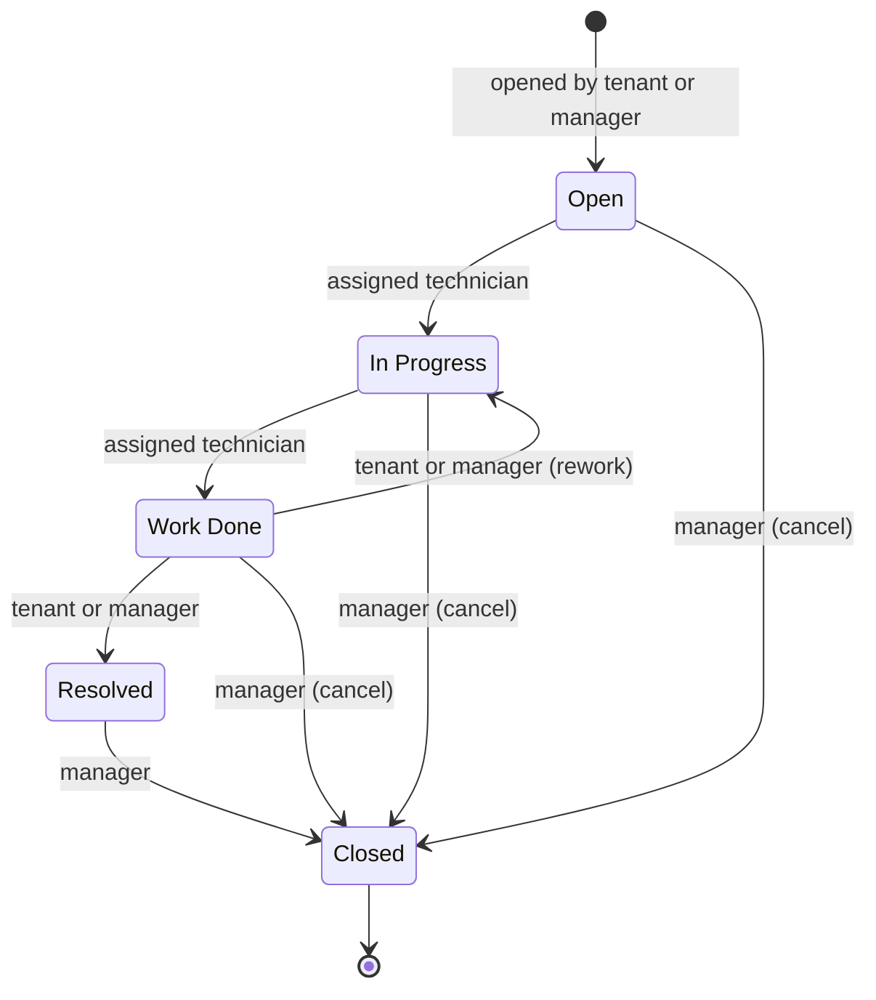

# Property Management System: Design Document

**Status:** design baseline, before implementation
**Date:** 2026-11-04
**Stack:** .NET 10, PostgreSQL

## Contents

1. [Overview](#1-overview)
2. [Actors and responsibilities](#2-actors-and-responsibilities)
3. [Entities and their roles](#3-entities-and-their-roles)
4. [Entity-relationship diagram](#4-entity-relationship-diagram)
5. [Ticket workflow](#5-ticket-workflow)
6. [Permission matrix](#6-permission-matrix)
7. [Business rules and invariants](#7-business-rules-and-invariants)
8. [Decision log](#8-decision-log)
9. [Open items](#9-open-items)
10. [Future improvements](#10-future-improvements)

---

## 1. Overview

### 1.1 Purpose

The system manages the day-to-day operation of a single residential building. It keeps track of who lives where, what rent is due and what has been paid, and how maintenance problems are reported, assigned, fixed, and recorded.

It serves two groups of people. **Building staff** (managers and technicians) need one reliable place to see units, tenants, finances, and open maintenance work. **Tenants** need a simple way to report a problem in their unit, follow its progress, confirm that it was fixed, and look at their own payment history.

The project is also a **portfolio piece** built to practice .NET development and system design. For that reason it is designed first: entities, relationships, business rules, workflow, and permissions are settled in this document before any database or code is created.

### 1.2 Scope

**In scope**

- One building made of units (private apartments, public spaces, and offices).
- Accounts for tenants, employees (managers and technicians), and administrators.
- Leases, occupants, move-out requests, monthly rent charges, and recorded payments.
- Maintenance tickets with categories, assignment by skill, a comment journal, and a full event timeline.
- Role-based and record-based access control.

**Not in scope for this design**

- Multiple buildings or properties (planned as a later improvement).
- Co-tenants, meaning several people who each sign the same lease (later improvement).
- Online payment processing. Payments are recorded manually by managers.
- Notifications, payroll, and general employee time tracking.

### 1.3 System at a glance

A building contains **units**. A unit is *private* (rented to a tenant), *public* (corridor, laundry room, garage, pool), or *office* (manager's office, rental office). Tenants rent private units through **leases**, and each lease generates monthly **charges** that are settled by **payments**.

**Employees** run the building. *Managers* oversee finances, accounts, leases, and maintenance. *Technicians* do the maintenance work and have **skills** that match ticket **categories**. **Admins** maintain the building's structure and bootstrap the system.

Any tenant, and any manager, can open a **maintenance ticket** against a unit. A manager assigns a technician with the right skill. The technician inspects, works, and reports the work done. The tenant confirms, and a manager closes the ticket. Every step is recorded.

### 1.4 Delivery phasing

The core system covers accounts and access, units and appliances, leases, occupants, move-out requests, and maintenance tickets with categories and events. A **financial milestone** follows: time entries (decided), plus charges, payments, and financial reports (planned, see section 9).

---

## 2. Actors and responsibilities

| Actor | Responsibilities |
|---|---|
| **Tenant** | Views own payment history. Requests move-out. Opens maintenance tickets for their own unit and comments on tickets they opened. Views the maintenance history of their unit for the period of their lease. Confirms completed work by setting a ticket to Resolved. Manages the occupants (family members) on their lease. Edits their own profile, including email. |
| **Technician** | Has a list of skills. Works on tickets assigned to them: starts work, reports work done, comments. Views the maintenance history of the whole property. Logs time on assigned tickets. Sees their own wage history. May request a category review on an assigned Open ticket. |
| **Manager** | Tracks financial data for the whole property. Creates tenant, technician, and manager accounts. Views all information about the property and each unit. Manages leases, occupants, and move-out requests. Adjusts unit rates and wages. Manages the skill list and appliances. Opens and assigns tickets, changes categories, and is the only role that can close a ticket. |
| **Admin** | Programmer-type account that maintains the building's structure: creates units, edits core unit data, and decommissions units. Creates, views, edits, and deactivates manager accounts (account data only, never wages). Changes any account's email. The first admin is how a new installation gets its first manager. Has no access to tickets, leases, payments, or wages. |
| **Occupant** | Not an actor. A household member listed on a lease (for example, a family member). Has no login. |

---

## 3. Entities and their roles

### 3.1 People and access

| Entity | Role in the system | Key points |
|---|---|---|
| **User** | The base record for every person with an account. | First name, last name, date of birth, phone number, email, active flag, created and updated timestamps. Email is the login identifier and is unique (case-insensitive). There is no username. Subtypes are Tenant, Employee, and Admin. |
| **UserCredential** | Holds the secrets and login state of a user. | Password hash, failed-attempt count, lockout end, last login. Kept apart from `User` so the domain model has no authentication concerns. |
| **Tenant** | A person who rents a private unit. | Emergency contact and status. Which unit they occupy comes from their lease, never from a column on the tenant. |
| **Employee** (abstract) | A staff member. | Hire date, termination date, employment status, emergency contact. Subtypes are Manager and Technician. |
| **Manager** | An employee with operational authority over the building. | No extra data. The role determines what they can see and do (section 6). |
| **Technician** | An employee who performs maintenance work. | Skills, assigned tickets, time entries. |
| **Admin** | A user type for structural and system administration. | No extra data. Can view and edit manager accounts. Has no access to tickets, leases, payments, or wages (a boundary that may be revisited later). |
| **WageHistory** | The hourly wage of an employee over time. | Wage, effective-from and effective-to dates, and who changed it. Append-only, so past labor costs stay correct. |
| **Skill** | A capability a technician can have, and also the list of ticket categories. | One shared list (for example Plumbing, Electrical, HVAC, General maintenance). Managed by managers. |
| **TechnicianSkill** | Links technicians to skills. | Optional certification expiry date. |

### 3.2 Building structure

| Entity | Role in the system | Key points |
|---|---|---|
| **Unit** | Any space in the building. | Type (Private, Public, Office), unique name (for example 101 or "Laundry room"), floor, area in m², bedrooms, bathrooms, balcony and kitchen flags, status (for example available, occupied, under maintenance, decommissioned). Bedrooms, bathrooms, balcony, and kitchen are only filled for spaces where they apply. Units are never deleted, only decommissioned. |
| **UnitRateHistory** | The listed monthly rent of a private unit over time. | Rate, effective date, who set it. The current listed rate is the latest entry. It applies to future leases only. Public and office units have no rate. |
| **Appliance** | A piece of equipment installed in a unit. | Type, brand, model, serial number, install date, free-form specifications (JSONB), status. A ticket can refer to one. |

### 3.3 Leasing and money

| Entity | Role in the system | Key points |
|---|---|---|
| **Lease** | Connects a tenant to a private unit for a period. | Start and end dates, agreed monthly rent, status. Replaces any "current tenant" column. The agreed rent is fixed per lease, so later rate changes never rewrite history. A unit with no active lease is vacant. |
| **Occupant** | A household member living under a lease. | Name, date of birth, relationship. Belongs to a lease. Not a user. |
| **MoveOutRequest** | The workflow for ending a tenancy. | Requested date, status, who requested it (tenant or manager on their behalf), who reviewed it, notes. Approval ends the lease. |
| **Charge** | An amount a tenant owes for a period. | Lease, period, type, amount, due date, voided flag. Generated monthly per active lease, and unique per lease, period, and type so generation can safely be repeated. |
| **Payment** | Money received against a charge. | Amount, date, method, reference, recorded by. Several payments can settle one charge. Paid, partial, and overdue are derived, not stored. |

### 3.4 Maintenance

| Entity | Role in the system | Key points |
|---|---|---|
| **MaintenanceTicket** | A reported problem in a unit, followed until it is closed. | Unit, optional appliance, category (a skill), creator, assigned technician (optional), title, description, status, closed reason, timestamps. Once Closed it is final and read-only. |
| **TicketComment** | A permanent entry in the ticket's journal. | Author, text, time. Cannot be edited or deleted. |
| **TicketEvent** | A record of everything that happens to a ticket. | Event type (status changed, category changed, assigned, unassigned, category review requested), from and to values, who, when, and a link to the explaining comment. Append-only. |
| **TimeEntry** | Hours a technician worked on a ticket. | Date, hours, note. Together with wage history it gives labor cost per ticket, unit, and category. Ships with the financial milestone. |

---

## 4. Entity-relationship diagram

The diagram is split into three parts to stay readable. Subtype tables (Tenant, Employee, Manager, Technician, Admin) use their parent's primary key, which is how table-per-type inheritance maps to the database. Entities that appear with only a key are **stubs** repeated from another part so you can see how the parts connect. Several `changed_by`, `reviewed_by`, and `recorded_by` columns point to managers.

### 4.1 People and access

### 4.2 Building, leasing, and money

### 4.3 Maintenance

### 4.4 Notes the diagram cannot express

- **Ticket event types:** `StatusChanged`, `CategoryChanged`, `Assigned`, `Unassigned`, `CategoryReviewRequested`. `from_value` and `to_value` hold the old and new status, category, or technician as text. `comment_id` points to the comment that explains the event and is required for `StatusChanged` and `CategoryReviewRequested`.
- **Who resolved or closed a ticket** is read from `ticket_event`. The ticket itself keeps only the timestamps and the closed reason.
- **Constraints to add in migrations:**
  - Unique `(lease, period, type)` on `charge`.
  - Exclusion constraint on `(unit, date range)` on `lease`, so leases never overlap.
  - Partial unique index so a lease has at most one pending move-out request.
  - Check constraints so Private units have a rate history and other unit types do not, and so fields like bedrooms are only set where they apply.
  - No overlapping effective-date ranges per employee in `wage_history`.
  - Case-insensitive unique email (`citext` or a unique index on the lowercased value).
- **Concurrency token** on `maintenance_ticket` using PostgreSQL's `xmin` system column, which is why it is not drawn.
- **Conventions in the diagram:** UUID keys, UTC `timestamptz`, `numeric` for money.
- **Time entry** is part of the design and the diagram, but its table is created with the financial milestone.

---

## 5. Ticket workflow

### 5.1 State diagram

### 5.2 Typical flow

1. A tenant opens a ticket for their unit and chooses a **category**.
2. A manager assigns a technician. The assignment list contains only technicians who have the skill matching the category.
3. The technician visits the unit and inspects the problem. The ticket is still **Open**.
4. If the technician agrees with the category, they set the ticket to **In Progress** and do the work.
5. If the problem belongs to another category, the technician keeps the ticket Open, posts a comment explaining their view, and **requests a category review**. The ticket then appears in the manager's review filter. The manager changes the category, which automatically clears the assigned technician. The manager then picks from a newly filtered list.
6. When the work is finished the technician sets **Work Done**.
7. The tenant checks the result. If satisfied they set **Resolved**. If not, they send it back to **In Progress** with a comment.
8. A manager sets **Closed**. Closing is final.

### 5.3 Transitions

| Transition | Who | Notes |
|---|---|---|
| Create (starts as Open) | Tenant (own unit, active lease), manager (any unit) | Category is required. The description is the first entry of the journal, so no comment is needed. |
| Open → In Progress | Assigned technician | Comment required. |
| In Progress → Work Done | Assigned technician | Comment required. |
| Work Done → Resolved | Tenant who opened the ticket. Manager when the ticket is stuck or was not opened by a tenant | Comment required. |
| Work Done → In Progress | Tenant who opened the ticket, manager | Rework. Comment required. |
| Resolved → Closed | Manager | Comment required. Closed reason is Completed. |
| Open, In Progress, or Work Done → Closed | Manager | Cancellation: duplicates, mistakes, withdrawn or abandoned tickets. Comment required. Closed reason is Cancelled. |

### 5.4 Workflow rules

- **Every status change must have a comment.** The comment is a normal ticket comment, linked from the `StatusChanged` event.
- **Closed is final.** A Closed ticket is fully read-only, including comments, for every role. There is no reopening. A related problem gets a new ticket.
- **Category changes** are only possible while the ticket is Open, only by a manager, and always clear the assigned technician. After work has started the category is frozen. If a wrong category is found later, cancel the ticket with a note and open a new one.
- **Assignment** is only possible to technicians whose skills include the ticket's category, and only while the ticket is Open. Once the ticket is In Progress the assigned technician cannot be changed. The assignment endpoint enforces the skill rule itself, not only the list shown to the manager.
- **Category review request:** a technician assigned to an Open ticket can request one, with a required comment. The manager's filter shows Open tickets whose latest category-related event is a review request. The request is answered when the manager changes the category, or when the ticket leaves Open.
- **Closed reason** is Completed exactly when the ticket was closed from Resolved, and Cancelled otherwise.
- **Comments are a permanent journal.** They cannot be edited or deleted. A mistake is corrected with a new comment.

---

## 6. Permission matrix

**Legend:** Yes = any record. Own = only their own records. Assigned = only tickets assigned to them. A dash means denied. Everything not listed is denied.

### Accounts and profiles

| Action | Tenant | Technician | Manager | Admin |
|---|---|---|---|---|
| Create tenant or technician account | — | — | Yes | — |
| Create manager account | — | — | Yes | Yes |
| Deactivate an account | — | — | Yes | Manager accounts |
| Edit own profile, including email | Own | Own | Own | Own |
| Change any account's email (audited) | — | — | Yes | Yes |
| View other users' profiles | — | Tenant name and unit, on assigned tickets | Yes | Manager accounts |
| Edit other users' profile data (name, phone, date of birth) | — | — | Pending (section 9) | Manager accounts |

Changing your own email requires the current password, a unique address, and confirmation of the new address through a link. Admins view and edit manager accounts without any access to wage history.

### Employees and wages

| Action | Tenant | Technician | Manager | Admin |
|---|---|---|---|---|
| View wage history | — | Own | Yes | — |
| Adjust any wage, including own | — | — | Yes | — |
| Manage the skill list and technician skills | — | View own | Yes | — |
| Log time entries (ticket not Closed) | — | Assigned | Yes | — |

### Units and appliances

| Action | Tenant | Technician | Manager | Admin |
|---|---|---|---|---|
| View units and appliances | Own unit | Yes | Yes | Yes |
| Create unit | — | — | — | Yes |
| Edit core data, decommission unit (rules apply) | — | — | Yes | Yes |
| Adjust listed rate, view rate history | — | — | Yes | — |
| Add, edit, or retire appliances | — | — | Yes | — |

### Leases, occupants, and move-out

| Action | Tenant | Technician | Manager | Admin |
|---|---|---|---|---|
| Create or end a lease | — | — | Yes | — |
| View leases | Own | — | Yes | — |
| Manage occupants | Own lease | — | Yes | — |
| Submit or cancel a move-out request | Own lease | — | Yes | — |
| Approve or reject a move-out request | — | — | Yes | — |

### Charges and payments

| Action | Tenant | Technician | Manager | Admin |
|---|---|---|---|---|
| View charges and payment history | Own | — | Yes | — |
| Record a payment, void a charge | — | — | Yes | — |
| Property-wide financial reports | — | — | Yes | — |

### Maintenance tickets

| Action | Tenant | Technician | Manager | Admin |
|---|---|---|---|---|
| Open a ticket, choosing a category | Own unit, active lease | — | Any unit | — |
| View ticket, comments, and event timeline | Own unit, created during their lease | Yes | Yes | — |
| Assign or reassign a technician (only while Open, eligible technicians only) | — | — | Yes | — |
| Change category (only while Open, clears the assigned technician) | — | — | Yes | — |
| Request category review (comment required, ticket Open) | — | Assigned | — | — |
| Open → In Progress | — | Assigned | — | — |
| In Progress → Work Done | — | Assigned | — | — |
| Work Done → Resolved | Opened by them | — | Yes | — |
| Work Done → In Progress | Opened by them | — | Yes | — |
| Resolved → Closed | — | — | Yes | — |
| Cancel (Open, In Progress, or Work Done → Closed) | — | — | Yes | — |
| Add a comment | Opened by them | Assigned | Yes | — |
| Edit or delete a comment | — | — | — | — |
| Reopen or change a Closed ticket, comments included | — | — | — | — |

Every status change in this table requires a comment.

### How the matrix is enforced

1. **Role** decides which endpoints a user can call at all.
2. **Resource check** decides whether the user may act on this specific record. Examples: the ticket's unit must match one of the tenant's leases and the ticket must have been created within those lease dates. A technician's transitions check that they are the currently assigned technician.
3. **Response model** decides which fields come back. Each role gets its own response shape, so a technician's ticket response never carries payment data.

Former tenants keep **read-only** access to their own payment and ticket history after their lease ends. Write actions additionally require an active lease.

---

## 7. Business rules and invariants

| Rule | Enforced in |
|---|---|
| Leases exist only on Private units. A tenant must be at least 18 at lease start. | Domain |
| A unit never has overlapping leases. | Database (exclusion constraint) and domain |
| Private units have a rate history. Other unit types have none. Fields like bedrooms are only set where they apply. | Database (check constraints) and domain |
| A unit can be decommissioned only with no active or scheduled lease and no unfinished tickets. Units are never deleted. | Domain |
| A lease has at most one pending move-out request. Approval ends the lease. | Domain and partial unique index |
| Rent charges are unique per lease, period, and type. | Database |
| Wage and rate histories are append-only and never overlap. | Domain and database |
| Email is unique, case-insensitive. | Database |
| Only the transitions in section 5.3 are possible. Every status change needs a comment. | `MaintenanceTicket` entity |
| A Closed ticket rejects every mutation (status, category, assignment, comments, time entries) from every role. | `MaintenanceTicket` entity |
| Category changes only while Open, only by a manager, and they clear the assignment. | `MaintenanceTicket` entity |
| A technician can be assigned only if their skills include the ticket's category. | Application service (assignment) |
| Assignment and reassignment are only possible while the ticket is Open. | `MaintenanceTicket` entity |
| Closed reason is Completed only when closed from Resolved. | `MaintenanceTicket` entity |
| Comments and events are append-only: there is no update or delete operation. | Domain, no endpoints, optionally database permissions |
| A technician can log time only on a ticket assigned to them. Entries stay on the ticket after unassignment, but the unassigned technician cannot add more. | Application service |

---

## 8. Decision log

### Structure and modeling

- Every kind of history (tickets, tenancies, payments, rates, wages, events) is its own entity pointing at its owner, never a list inside another entity.
- A **Lease** entity replaces the idea of a tenant "stack" on a unit. Vacancy is the absence of an active lease.
- The property is **not** a tenant of public units. Public and office units simply have no leases.
- Single building for now. Multiple properties are a later improvement.
- Co-tenants are deferred. Household members are **Occupants** (renamed from "subtenants").
- Unit "Rooms" means **bedrooms**. A **floor** and a **status** are added.
- A unit's rate is stored in `unit_rate_history`, and a lease keeps its own agreed rent, so rate changes never rewrite history.
- **Appliance** is its own table, with a JSONB specifications column.
- Removing a unit means **decommissioning** it, with rules.

### Users and access

- A pure domain `User` with a separate **credentials** table.
- **Email is the only login identifier.** There is no username. Emails are unique (case-insensitive).
- Tenant, Employee, and Admin are subclasses of User. Manager and Technician are subclasses of Employee.
- Admin is a user type with no data of its own.
- A live-in superintendent would use a separate account with a personal email for their unit.
- Wages and rates have effective-dated history. Employees have an hourly wage.
- Managers can adjust their own wage. The README records this, and attaching an approval document (for example from a board of directors) is a future improvement.
- Every user can edit their own profile, including email, with password confirmation, a unique address, and a confirmation link.
- Managers and admins can change any account's email, audited.
- Admins can create, view, edit, and deactivate manager accounts, and change any account's email. Managers can deactivate any account. The system starts with at least one admin account, from which the first manager is created.
- Admins have no access to tickets, leases, payments, or wages. This may change in the future if it becomes necessary.
- Technicians see their own wage history and only limited tenant information (name and unit) on assigned tickets.
- Admins can view units and appliances. Managers and admins can both edit core unit data and decommission units. Only admins create units.
- Managers add, edit, and retire appliances and manage the skill list.
- Former tenants keep read-only access to their own history.
- Subclassing does **not** protect financial data from technicians. Authorization policies and role-specific responses do. The README states this.

### Leasing and money

- Payments use two concepts: **Charge** (what is owed) and **Payment** (what was received).
- Tenants manage occupants on their own lease. Managers can too.
- Tenants and managers can submit and cancel move-out requests. Managers approve or reject them, and `requested_by` records who submitted it.

### Maintenance

- Ticket statuses: Open, In Progress, **Work Done**, Resolved, Closed.
- The assigned technician moves a ticket to In Progress and to Work Done. The tenant who opened it accepts by setting Resolved. A manager closes it.
- A manager can resolve a stuck ticket, and can cancel a ticket before it is Resolved with a required comment.
- Rework is possible from Work Done back to In Progress, by the tenant or a manager, with a comment.
- **Closed is final and fully read-only**, including comments. No reopening, not even by a manager. A related problem gets a new ticket.
- A ticket has a required **category**, which is a skill. Only technicians with that skill appear in the assignment list.
- **Category can only change while the ticket is Open**, only by a manager, and the change clears the assigned technician.
- A technician who disagrees with the category keeps the ticket Open, comments, and **requests a category review**. The manager has a simple filter for these.
- **Every status change must have a comment.**
- A `closed_reason` (Completed or Cancelled) is stored on the ticket.
- Ticket comments are **permanent**: no editing, no deleting, no edit history. Technician notes are ordinary comments and are visible to tenants.
- A single append-only `ticket_event` table replaces a status-history table. It records status changes, category changes, assignments, unassignments, and category review requests.
- Tenants see every ticket of their unit created during their lease.
- Technicians can log time while a ticket is Open (for the inspection visit). Entries stay on the ticket after unassignment. Time entries ship with the financial milestone.
- **Assignment** and reassignment are only possible while a ticket is Open. A manager cannot change the technician once the ticket is In Progress.

### Documentation commitments for the README

- Access control is enforced by authorization policies, not by the class hierarchy.
- Managers can change their own wage, with the approval-document improvement noted.
- Comments are permanent, so a comment containing sensitive information by mistake cannot be removed.

---

## 9. Open items

These have not been decided yet.

- **Architecture:** not decided. The current plan is to build the domain layer and a persistence layer with EF Core, connect them, and then look at a testing database. An earlier suggestion (separate Domain, Application, Infrastructure, and Api layers, with integration tests on a real PostgreSQL using Testcontainers) remains an option to revisit.
- **Technical conventions:** the authentication scheme, error format, API versioning, logging, and local startup tooling are not decided.
- **Bootstrapping:** how the first admin account is created is not decided. What is decided is that the system starts with at least one admin, from which the first manager is created.
- **Dismissing a category review request:** currently a request ends only when the category changes or the ticket leaves Open.
- **Technician unavailable after work has started:** since the technician cannot be changed once a ticket is In Progress, the current answer is to cancel the ticket with a comment and open a new one.
- **Editing other users' profile data:** whether managers can edit another user's name, phone, or date of birth. Today managers can change any email and deactivate any account, and admins can edit manager accounts.
- **Ticket priority:** not modeled yet.
- **Financial milestone contents:** time entries are decided to ship with it. Charges, payments, and financial reports are planned for it too, but that grouping is not confirmed.

---

## 10. Future improvements

- Multiple properties.
- Co-tenants (several people on one lease).
- Approval document attached to manager wage changes.
- Notifications, for example for category review requests and assignments.
- A manager-only redaction of comment text, with an audit record, if permanent comments prove too strict.
- Online payment processing.
- A separate ticket category table with a skill mapping, if one category ever needs several skills.
- Email verification at account creation.
